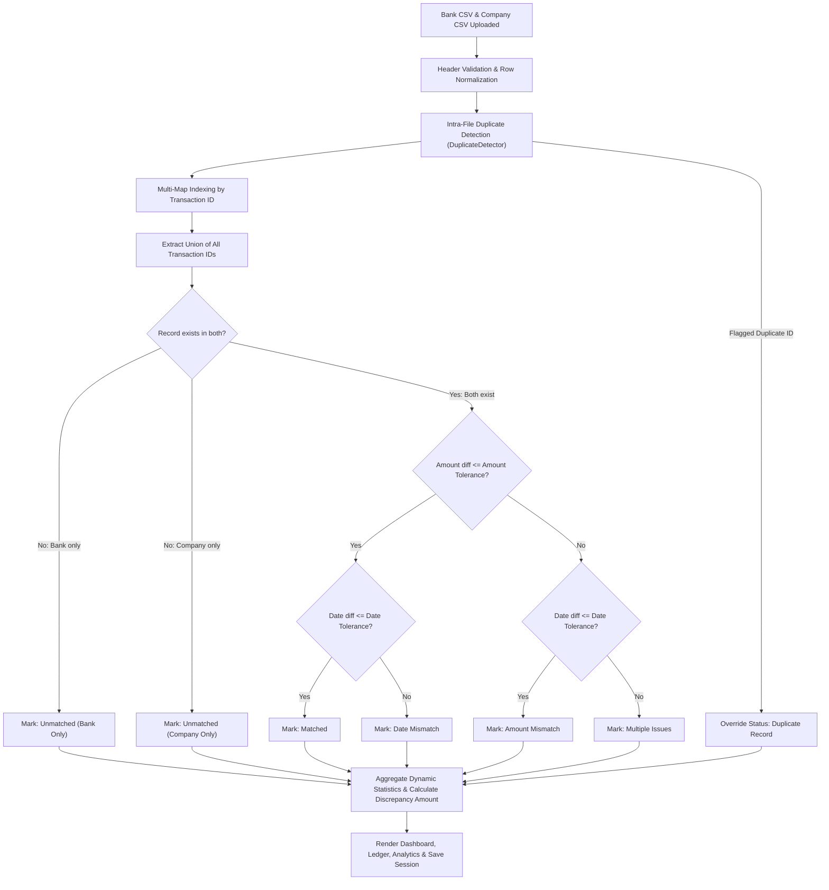

# ReconcileX – Smart Financial Transaction Reconciliation System

[-0ea5e9?style=flat-square)](https://github.com)
[](https://github.com)
[](https://github.com)
[](LICENSE)

---

## 1. Project Overview

**ReconcileX** is an enterprise-grade, high-performance financial transaction reconciliation and audit platform built for modern fintech environments. It automates the arduous, error-prone process of comparing bank statements against internal company accounting ledgers, instantly surfacing matches, discrepancies, duplicate billings, and unpresented ledger items with mathematical precision.

Engineered specifically as a lightweight, zero-dependency, serverless application, ReconcileX runs entirely within any modern web browser without requiring a backend server or external database. It combines algorithmic integrity, dynamic visualizations, automated audit observations, and compliance-grade export capabilities into a unified dark-mode fintech interface.

---

## 2. Problem Statement

Financial reconciliation is traditionally one of the most tedious and risk-prone workflows in corporate accounting and treasury operations:
- **Human Error & Spreadsheet Fatigue:** Manual visual inspection in Excel across thousands of rows leads to missed discrepancies and billing leakage.
- **Timing & Settlement Lags:** Banks frequently process transactions days after company invoices are cut, causing false-positive mismatch flags.
- **Duplicate Charges & Fraud Risk:** Vendor double-swipes or duplicate payment gateway webhook fires often go undetected until year-end audits.
- **Data Privacy Concerns:** Uploading proprietary financial transaction data to cloud-hosted SaaS backend databases introduces compliance risks (GDPR, SOC2, PCI-DSS).

---

## 3. Proposed Solution

**ReconcileX** solves these challenges through:
1. **Client-Side Edge Execution:** 100% of transaction processing occurs locally inside the browser memory. Zero sensitive financial data ever leaves the user's workstation.
2. **Multi-Dimensional Matching Engine:** Uses primary key indexing combined with configurable amount tolerance (e.g. currency variations, gateway fee absorptions) and date tolerance (absorbing T+1 or T+2 settlement lags).
3. **Intra-File Duplicate Detection:** Scans source statements independently to flag duplicate transaction IDs before matching begins.
4. **Automated AI-Style Audit Insights:** Generates actionable natural-language audit observations explaining net variances, unrecorded bank charges, and prioritized financial leakages.
5. **Interactive Executive Dashboards & PDF Export:** Live Chart.js analytics and instant one-click professional audit PDF generation powered by `jsPDF` and `jsPDF-AutoTable`.

---

## 4. Key Features

| Module | Features & Capabilities |
| :--- | :--- |
| **Command Center (Dashboard)** | 7 dynamic KPI metric cards (Total Records, Matched, Unmatched, Mismatches, Duplicates, Match Rate %, Total Discrepancy Amount). Net settlement variance tracker. 4 Chart.js charts: Doughnut breakdown, Status distribution, Volume comparison, and Date trend. |
| **CSV Upload & Ingestion** | Dual drag-and-drop dropzones for Bank Statement and Company Records. File size and record counter chips. PapaParse engine supporting quoted commas and escaped quotes. Built-in sample CSV template downloads and a **One-Click "Load Demo Data" button**. |
| **Core Reconciliation Engine** | Sub-millisecond matching across arbitrary datasets. Categorizes records into: `Matched`, `Unmatched in Bank`, `Unmatched in Company`, `Amount Mismatch`, `Date Mismatch`, `Duplicate Record`, and `Multiple Issues`. |
| **Transactions Ledger** | Real-time full-text search across IDs, descriptions, and reference numbers. Status dropdown filters, date range filter, column sorting, pagination controls (10/25/50/100 rows), and a comprehensive **Transaction Audit Modal** with side-by-side comparison. |
| **Analytics & Audit Intelligence** | Discrepancy breakdown metrics, Top 5 largest discrepancies table (ranked by leakage impact), and rule-based Automated Audit Observations. |
| **Report Generation** | Export complete results or targeted CSVs (Mismatches-only, Unmatched-only, Duplicates-only). Generate branded, confidential executive audit PDF reports with executive KPI summaries and itemized ledger tables. |
| **Session History & Persistence** | Browser `LocalStorage` session management with automatic reload on page refresh, session restoration, and deletion. |
| **Settings & Tolerances** | Configurable Amount Tolerance (e.g. ₹5.00), Date Tolerance (0–30 days), Multi-currency display (INR ₹, USD $, EUR €, GBP £, JPY ¥), auto-reconcile toggle, and factory reset. |

---

## 5. Technology Stack

- **Frontend Core:** HTML5, CSS3 (Custom Dark Fintech Design System, CSS Grid, Flexbox, CSS Custom Properties).
- **Application Logic:** Vanilla JavaScript (ES6+ modular IIFE architecture). Zero frontend frameworks (no React, Angular, or Vue overhead).
- **Libraries & Plugins (Loaded via CDN):**
  - [PapaParse 5.4.1](https://www.papaparse.com/) – RFC 4180 compliant CSV parsing.
  - [Chart.js 4.4.1](https://www.chartjs.org/) – Responsive HTML5 canvas charts.
  - [jsPDF 2.5.1](https://github.com/parallax/jsPDF) & [jsPDF-AutoTable 3.8.2](https://github.com/simonbengtsson/jsPDF-AutoTable) – Vector PDF report generation.
  - [Font Awesome 6.5.1](https://fontawesome.com/) – Crisp UI iconography.
- **Storage:** Browser `window.localStorage` with quota protection and fallback pruning.

---

## 6. Project Folder Structure

```text
ReconcileX/
│
├── index.html                     # Main application entry point (SPA layout)
├── README.md                      # Comprehensive project documentation
│
├── css/
│   ├── style.css                  # Core design system, variables, sidebar, layout & typography
│   ├── dashboard.css              # KPI cards, volume strip, chart containers, empty states
│   ├── upload.css                 # Drag-and-drop dropzones, file chips, validation alerts
│   ├── transactions.css           # Table filters, data table, pagination, detail modal
│   ├── analytics.css              # Audit observation cards, financial metrics grid, top leakage table
│   ├── reports.css                # Export cards, format pills, download triggers
│   └── responsive.css             # Tablet & mobile responsive breakpoints (<=992px, <=768px, <=480px)
│
├── js/
│   ├── app.js                     # Global controller, routing, demo loader, toast notifications
│   ├── csvReader.js               # PapaParse wrapper, file reader, demo datasets, template downloads
│   ├── validation.js              # Header alias mapping, type checks, date/amount sanitization
│   ├── duplicateDetector.js       # Intra-file duplicate transaction ID detection
│   ├── reconciliation.js          # Core matching algorithm with tolerances and statistical aggregator
│   ├── dashboard.js               # KPI card animations and view lifecycle
│   ├── charts.js                  # Chart.js instances, palette, and lifecycle management
│   ├── transactions.js            # Table search, multi-filter, sort, pagination, and detail modal
│   ├── analytics.js               # Rule-based AI audit insights and top leakage ranking
│   ├── reportGenerator.js         # CSV export generators and jsPDF AutoTable report builder
│   ├── storage.js                 # LocalStorage session manager, history saver, and restoration
│   └── settings.js                # Tolerance settings, currency formats, and preferences
│
├── sample-data/
│   ├── bank-statement.csv         # Realistic sample bank statement dataset
│   ├── company-records.csv        # Realistic sample company records dataset
│   └── advanced-test-data.csv     # Advanced dataset (quoted commas, duplicates, multiple issues)
│
├── tests/
│   └── test-suite.js              # Automated Node.js integration & engine test suite (28 assertions)
│
├── assets/
│   ├── icons/
│   │   └── logo.svg               # Vector brand emblem and favicon
│   └── images/
│
└── reports/                       # Target directory for exported audits
```

---

## 7. How the Reconciliation Algorithm Works

The algorithm executes in sequential pipeline stages:



### Reconciliation Rules Matrix

| Condition | Status | Severity |
| :--- | :--- | :--- |
| `transaction_id` in both, amounts equal within tolerance, dates equal within tolerance | **Matched** | `Success` |
| `transaction_id` in both, amounts differ > tolerance, dates match | **Amount Mismatch** | `Danger` |
| `transaction_id` in both, amounts match, dates differ > tolerance | **Date Mismatch** | `Info` |
| `transaction_id` in both, both amount and date differ > tolerance | **Multiple Issues** | `Danger` |
| `transaction_id` exists only in Bank Statement | **Unmatched (Bank Only)** | `Warning` |
| `transaction_id` exists only in Company Ledger | **Unmatched (Company Only)** | `Warning` |
| `transaction_id` appears multiple times within either file | **Duplicate Record** | `Danger` |

---

## 8. CSV Data Format Requirements

Source CSV files must contain at least the following four columns (headers are case-insensitive and allow standard aliases such as `txn_id`, `amount`, `particulars`):

```csv
transaction_id,date,amount,description,reference_number
TXN001,2026-10-30,5000.00,Client Retainer Fee,REF-1001
TXN002,2026-10-30,2500.00,Cloud Infrastructure AWS,REF-1002
TXN003,2026-10-30,3000.00,Office Supplies Global,REF-1003
```

- **`transaction_id`**: Alphanumeric unique identifier (e.g. `TXN001`, `INV-9021`).
- **`date`**: ISO format `YYYY-MM-DD` (also supports standard DD-MM-YYYY).
- **`amount`**: Numeric value (currency symbols and formatting commas are automatically stripped and normalized).
- **`description`**: Narrative text (quoted strings with commas supported).
- **`reference_number`** *(Optional)*: Secondary tracking or cheque reference.

---

## 9. How to Run the Application

Because ReconcileX is a serverless client-side application, running it requires **zero installation**:

### Option 1: Direct File Launch (Quickest)
Simply double-click `index.html` or open it with any web browser (Chrome, Edge, Firefox, Safari).

### Option 2: Local HTTP Server (Recommended)
You can serve the folder using any lightweight web server:

**Using Python 3:**
```bash
python -m http.server 8000
```
Then visit `http://localhost:8000` in your browser.

**Using Node.js (npx serve):**
```bash
npx serve .
```

### Running the Automated Test Suite:
ReconcileX includes a Node.js automated test suite that validates the reconciliation engine, duplicate detection, tolerance logic, and storage integrity:
```bash
node tests/test-suite.js
```
*(All 28 assertions pass across sample and edge-case datasets).*

---

## 10. Suggested Live Demo Flow for Hackathon Judges

To present ReconcileX to hackathon judges with maximum impact in under 3 minutes:

1. **Introduction (30s):**
   - Point out the dark fintech interface inspired by modern corporate treasury platforms.
   - Mention that ReconcileX runs 100% in-browser with zero backend, ensuring zero corporate data leaks.

2. **Instant Demo Load (30s):**
   - Click the topbar button **"Load Demo"** or go to the **Reconciliation** tab and click **"Load Demo Sample Data"**.
   - Notice how both file cards load instantly with row counts and file sizes, and the engine automatically reconciles in sub-milliseconds.

3. **Dashboard & Visualizations (45s):**
   - Highlight the 7 live KPI cards (Total Records, Matched, Mismatches, Duplicates, Match Rate %, Total Discrepancy).
   - Point out the **Net Settlement Variance** strip and show how the 4 Chart.js charts clearly visualize volume vs variance.

4. **Transactions Ledger & Audit Modal (45s):**
   - Navigate to **Transactions**. Search for `"Office"` or filter by `"Amount Mismatch"`.
   - Click **"Details"** on `TXN003` to show the side-by-side Bank vs Company comparison modal. Show the exact variance and audit note.

5. **Analytics & Automated Observations (30s):**
   - Navigate to **Analytics**. Show the **Automated Audit Observations** generated from actual parsed data (e.g., manual review alerts, unrecorded bank charges).
   - Show the **Top 5 Priority Discrepancies** table identifying the largest financial leakages.

6. **Executive PDF Export (30s):**
   - Navigate to **Reports** and click **"Generate & Download Audit PDF"**.
   - Open the generated PDF to show the clean executive layout, summary KPI box, and itemized reconciliation audit table.

---

## 11. Team Contribution Suggestions (Team of 3–4 CS Students)

| Student Role | Responsibility Area | Key Files |
| :--- | :--- | :--- |
| **Student 1 (Team Lead & Full-Stack Architect)** | Core reconciliation engine, duplicate detection algorithms, tolerances, integration test suite. | `js/reconciliation.js`, `js/duplicateDetector.js`, `tests/test-suite.js` |
| **Student 2 (Frontend & UI/UX Designer)** | Dark fintech design system, responsive layout, sidebar, transaction details modal, and empty states. | `index.html`, `css/*.css` |
| **Student 3 (Data & Parsing Specialist)** | CSV ingestion with PapaParse, input validation, header alias mapping, error handling, sample datasets. | `js/csvReader.js`, `js/validation.js`, `sample-data/*.csv` |
| **Student 4 (Analytics & Reporting Engineer)** | Chart.js visual analytics, automated audit insights engine, jsPDF AutoTable report generation, LocalStorage sessions. | `js/charts.js`, `js/analytics.js`, `js/reportGenerator.js`, `js/storage.js` |

---

## 12. Future Enhancements

- [ ] **AI-Powered Fuzzy Matching:** Levenshtein string distance algorithm for matching differing vendor descriptions.
- [ ] **Direct Open Banking API Integrations:** Plaid / Yodlee webhook sync for automated real-time transaction ingestion.
- [ ] **Multi-Currency FX Rate Conversion:** Auto-fetch live forex exchange rates for cross-border transaction reconciliation.
- [ ] **Role-Based Audit Approval Workflows:** Dual-authorization approvals for writing off discrepancies exceeding threshold limits.

---

## 13. License

Distributed under the **MIT License**. Free for academic, competition, and enterprise use. Developed for hackathons and financial innovation.
